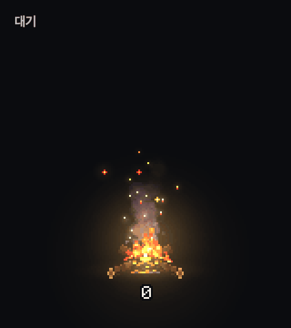

# Token Bonfire

[English](README.md) · 한국어

**Claude Code와 Codex가 태우는 토큰을 바탕화면 모닥불로 보여 주는 macOS 앱.**

> [!NOTE]
> 실행 파일은 배포하지 않습니다. macOS 13 이상에서 직접 빌드해 씁니다. 빌드한 앱은 ad-hoc 서명이며 Apple 공증을 받지 않았습니다. Apple Silicon에서 실행을 확인했습니다.

```sh
git clone https://github.com/tinkerer0/token_bonfire.git
cd token_bonfire
bash scripts/build.sh
open dist/TokenBonfire.app
```

Xcode Command Line Tools만 있으면 됩니다. 외부 의존성은 없습니다.



토큰을 쓰면 동전이 불에 떨어지고, 많이 쓸수록 불이 커집니다. 아래 숫자는 앱을 켠 뒤 태운 토큰 수입니다.

## 사용법

불을 끌어서 원하는 자리에 둡니다. 불을 누르면 옆에 설정 창이 뜨고, 메뉴바의 불꽃 아이콘에도 같은 항목이 있습니다. 여기서 목표, 집계 초기화, 집계 대상(Claude Code·Codex), 크기(0.75~3배), 불 색(주황·파랑·초록·보라), 숫자 표시, 불 단계 기준, 단계 미리보기, 로그인 시 자동 실행을 고를 수 있습니다. 불이 없는 투명한 자리의 클릭은 아래 창으로 넘어갑니다.

## 집계 방식

- 앱을 켠 순간 0에서 시작합니다. 켜 둔 동안 계속 쌓이고, 초기화하거나 끄면 0이 됩니다.
- 세는 양은 입력 + 출력입니다. 캐시에 쓰거나 캐시에서 읽은 입력은 세지 않습니다.
- 불은 대기·약·중·강·폭주 다섯 단계입니다. 기본값은 분당 토큰이 8천·2.5만·7만을 넘으면 중·강·폭주가 되며, 메뉴의 불 단계 기준에서 바꿀 수 있습니다.
- 한꺼번에 들어온 양은 15초쯤에 걸쳐 동전으로 나눠 떨어지고, 숫자는 동전이 불에 들어갈 때 오릅니다.
- 숫자는 1000 미만은 정수, 그 위는 K·M·B·T로 줄여 씁니다.
- 목표를 정하면 숫자가 `1.2M/5M`처럼 현재/목표로 바뀌고 0부터 셉니다. 목표를 채우면 불이 크게 타오르고 숫자가 금색으로 바뀌어 계속 깜빡이며, 소리가 나고 알림을 허용했다면 macOS 알림이 한 번 옵니다. 정한 시간(기본 24시간, 끌 수 있음)마다 0부터 다시 세며, 그 시간 안에 앱을 껐다 켜면 이어서 셉니다(꺼져 있던 동안 쓴 양은 빠집니다).
- 목표 창에는 그 양이 구독 주간 한도의 대략 몇 %인지 나옵니다. 한 계정의 사용 기록으로 잰 어림(주간 Claude Code 약 3,700만·Codex 약 3,200만 토큰)이라 요금제마다 다릅니다.

세션 기록에서 사용량 숫자와 시각만 읽으며 네트워크 연결은 없습니다. 자세한 내용은 [PRIVACY.md](PRIVACY.md)에 있습니다.

## 개발

```sh
bash scripts/test.sh
BIN=dist/TokenBonfire.app/Contents/MacOS/TokenBonfire
$BIN --scan 30                              # 30초 동안 잡힌 사용량
$BIN --render out.png --tier 3 --seconds 5  # 화면 없이 한 장 그리기
$BIN --demo frames --seconds 2              # 단계별 낱장
```

토큰 집계는 `Sources/TokenUsage.swift`, 불 단계와 숫자 표기는 `Sources/BurnModel.swift`, 그림 합성은 `Sources/BonfireRenderer.swift`에 있습니다. `Resources/`의 그림은 `tools/bake/pixelfx`에 [pixelfx](https://github.com/tinkerer0/pixelfx)를 두고 `node tools/bake/bake.mjs`로 다시 만들 수 있습니다.

## Feedback

제가 이런 분야를 접한 지 얼마 안 돼서 부족한 점이 많습니다. 고칠 점이나 알려주실 내용이 있다면 issue나 PR로 남겨주시면 너무 감사하겠습니다.

## License

코드는 [MIT](LICENSE)입니다. 그림은 pixelfx(MIT)로 그렸으며 출처와 라이선스는 [THIRD_PARTY_NOTICES.md](THIRD_PARTY_NOTICES.md)에 있습니다.
