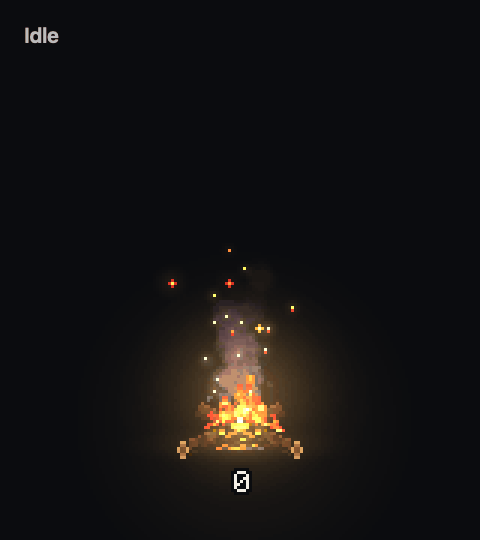

# Token Bonfire

English · [한국어](README.ko.md)

**A macOS desktop bonfire that burns the tokens Claude Code and Codex use.**

> [!NOTE]
> No prebuilt binary is distributed. Build it yourself on macOS 13 or later. The built app is ad-hoc signed and not notarized by Apple. Verified on Apple Silicon.

```sh
git clone https://github.com/tinkerer0/token_bonfire.git
cd token_bonfire
bash scripts/build.sh
open dist/TokenBonfire.app
```

Only the Xcode Command Line Tools are required. There are no external dependencies.



When tokens are used, coins drop into the fire, and the more you use, the bigger it burns. The number below is how many tokens have burned since the app was launched.

## Usage

Drag the fire to wherever you want it. Right-click the fire, or click the flame icon in the menu bar, to reset the count, change the size (0.75x to 3x), pick what to count (Claude Code, Codex), adjust the stage thresholds, show or hide the number, launch at login, or preview each stage. Clicks on the transparent area around the fire pass through to the window below. The app's menus are in Korean.

## How it counts

- The count starts at 0 when the app launches. It keeps adding up while the app runs, and goes back to 0 when you reset or quit.
- It counts input + output tokens. Input written to or read from the cache is not counted.
- The fire has five stages: idle, low, medium, high, and max. By default it becomes medium, high, and max above 8K, 25K, and 70K tokens per minute, and you can change these thresholds from the menu.
- A burst of tokens is spread into coins over about 15 seconds, and the number goes up as each coin lands in the fire.
- The number is a plain integer below 1000 and is shortened with K, M, B, and T above that.

The app reads only usage numbers and timestamps from session logs and makes no network connections. See [PRIVACY.md](PRIVACY.md) (Korean) for details.

## Development

```sh
bash scripts/test.sh
BIN=dist/TokenBonfire.app/Contents/MacOS/TokenBonfire
$BIN --scan 30                              # usage picked up over 30 seconds
$BIN --render out.png --tier 3 --seconds 5  # draw one frame without a window
$BIN --demo frames --seconds 2              # frames for each stage
```

Token counting lives in `Sources/TokenUsage.swift`, fire stages and number formatting in `Sources/BurnModel.swift`, and compositing in `Sources/BonfireRenderer.swift`. The art in `Resources/` can be rebuilt by placing [pixelfx](https://github.com/tinkerer0/pixelfx) at `tools/bake/pixelfx` and running `node tools/bake/bake.mjs`.

## Feedback

I am new to this field and there is a lot I still get wrong. If you see something to fix or something I should know, an issue or PR would be very much appreciated.

## License

The code is [MIT](LICENSE). The art is drawn with pixelfx (MIT); sources and licenses are in [THIRD_PARTY_NOTICES.md](THIRD_PARTY_NOTICES.md).
